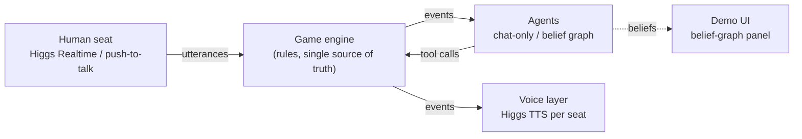

# AvalonBot

LLM agents playing a 5-player game of **The Resistance: Avalon** by voice. They bluff, accuse and vote, and a human takes one seat at the table.

Each agent keeps a **belief graph**: its own estimate of how likely each other player is to be evil, plus the evidence behind it (votes, team proposals, accusations), tagged by turn.

> Built for the Boson AI hackathon (Oct 2026). Voice runs on Higgs TTS and Higgs Realtime.

## Goals

- **Live voice game:** each bot argues in its own Higgs TTS voice, and the human joins through Higgs Realtime. A side panel shows each bot's belief graph updating as the game goes.
- **Ablation:** a self-play experiment measuring whether belief graphs beat plain chat history at finding the spies.

## Scope

| Tier | Included |
| --- | --- |
| MVP | 5-player rules engine (Merlin, Assassin, 1 Minion, 2 Loyal Servants); LLM agents in two conditions (chat-only vs belief graph); headless self-play runner; metrics script |
| MVP | Human plays one seat by voice; each bot speaks in its own voice |
| Stretch | Live belief-graph panel; avatar for the speaking bot; human can interrupt a bot mid-accusation |
| Out of scope | Percival, Morgana, Lady of the Lake; more than 5 players; fine-tuning |

## Architecture



- The **game engine** is the single source of truth. Agents only see events and act through tool calls, so the same agent code runs in live play and in self-play.
- The **belief graph** is a small store kept by each agent: P(evil) for every other player, plus evidence edges (voted with, proposed, accused) tagged by turn. Each turn it's written into the agent's prompt as a compact table.
- The **voice layer** listens to game events and has no game logic. Bot lines go through TTS, and the human's speech is transcribed into lines. Team picks and votes go through the UI, not speech.

## Evaluation

The evil team always plays the chat-only baseline, and only the good team's condition changes. That way any difference in results comes from the belief graph.

| Condition | Good team | Evil team |
| --- | --- | --- |
| A (baseline) | Chat history only | Chat history only |
| B (belief graph) | Chat history + belief graph | Chat history only |
| C (optional) | Belief graph updated by deterministic vote rules | Chat history only |

**Metrics, per condition:**
- **Good-team win rate,** with 95% bootstrap confidence intervals.
- **Spy-identification accuracy:** at game end, are a good player's top-2 suspects exactly the two evil players?
- **Brier score** of each good player's P(evil) estimates against the true roles (B and C only).
- **Merlin-survival rate:** the share of good-team wins that survive the Assassin's guess.

**Runs:** about 200 games per condition, with seats and roles shuffled under fixed seeds and the same model and temperature everywhere.

## Getting started

> Work in progress. Setup instructions will land here once the engine and runner exist.

```bash
git clone https://github.com/KhuzemahHQ/AvalonBot.git
cd AvalonBot
python -m venv .venv
# Windows: .venv\Scripts\activate   |   macOS/Linux: source .venv/bin/activate
cp .env.example .env   # add BOSON_API_KEY and your LLM provider key
```

## Acknowledgements

The rules engine and baseline agents are adapted from
[Avalon-LLM / AvalonBench](https://github.com/jonathanmli/Avalon-LLM)
(Light et al., *AvalonBench: Evaluating LLMs Playing the Game of Avalon*, and
*Strategist: Learning Strategic Skills by LLMs via Bi-Level Tree Search*, ICLR 2025).
