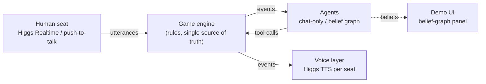

# AvalonBot

LLM agents playing a 5-player game of **The Resistance: Avalon** by voice. They bluff, accuse and vote, and a human takes one seat at the table.

Each agent keeps a **belief graph**: its own estimate of how likely each other player is to be evil, plus the evidence behind it (votes, team proposals, accusations), tagged by turn.

> Built for the Boson AI hackathon (Oct 2026). Voice runs on Higgs TTS and Higgs Realtime.
> 
> 📖 **Deep Dive:** See [ARCHITECTURE_AND_DECISIONS.md](ARCHITECTURE_AND_DECISIONS.md) for the complete design log, engineering choices, evaluation math, and empirical discoveries regarding Boson AI's speech tags.

## Goals

- **Live voice game:** each bot argues in its own Higgs TTS voice, and the human joins through Higgs Realtime. A side panel shows each bot's belief graph updating as the game goes.
- **Ablation:** a self-play experiment measuring whether belief graphs beat plain chat history at finding the spies.

## Scope

| Tier | Included |
| --- | --- |
| MVP | 5-player rules engine (Merlin, Assassin, 1 Minion, 2 Loyal Servants); LLM agents in two conditions (chat-only vs belief graph); headless self-play runner; metrics script |
| MVP | Human plays one seat by voice; each bot speaks in its own voice |
| Stretch | Live belief-graph panel; avatar for the speaking bot; human can interrupt a bot mid-accusation |
| Out of scope | Lady of the Lake; more than 5 players; fine-tuning |

## Architecture



- The **game engine** is the single source of truth. Agents only see events and act through tool calls, so the same agent code runs in live play and in self-play.
- The **belief graph** is a small store kept by each agent: P(evil) for every other player, plus evidence edges (voted with, proposed, accused) tagged by turn. Each turn it's written into the agent's prompt as a compact table.
- The **voice layer** listens to game events and has no game logic. Bot lines go through TTS, and the human's speech is transcribed into lines. Team picks and votes go through the UI, not speech.

## Evaluation

The evil team always plays the chat-only baseline, and only the good team's condition changes. That way any difference in results comes from the belief graph.

| Condition | Good team | Evil team |
| --- | --- | --- |
| A (baseline) | Chat history only | Chat history only |
| B (belief graph) | Chat history + belief graph | Chat history only |
| C (optional) | Belief graph updated by deterministic vote rules | Chat history only |

**Metrics, per condition:**
- **Good-team win rate,** with 95% bootstrap confidence intervals.
- **Spy-identification accuracy:** at game end, are a good player's top-2 suspects exactly the two evil players?
- **Brier score** of each good player's P(evil) estimates against the true roles (B and C only).
- **Merlin-survival rate:** the share of good-team wins that survive the Assassin's guess.

**Runs:** about 200 games per condition, with seats and roles shuffled under fixed seeds and the same model and temperature everywhere.

## Getting started

```bash
git clone https://github.com/KhuzemahHQ/AvalonBot.git
cd AvalonBot
python -m venv .venv
# Windows: .venv\Scripts\activate   |   macOS/Linux: source .venv/bin/activate
pip install -r requirements.txt
cp .env.example .env   # fill in your keys, then: chmod 600 .env
python -m pytest tests -q
```

`.env` holds `BOSON_API_KEY` for voice, plus `OPENAI_BASE_URL`, `OPENAI_API_KEY` and `OPENAI_MODEL`
for the LLM players. Any OpenAI-compatible endpoint works, such as a Boson Marketplace key for
`gpt-6.1-sol`. Never commit `.env`; git ignores it.

## Play through Codex CLI

Run `codex login` once with your ChatGPT account, then:

```bash
python -m arena check --config configs/arena/codex_chat_only.yaml
python -m arena run --config configs/arena/codex_chat_only.yaml --run-dir runs/codex/chat_only
```

Use `codex_belief_graph.yaml` or `codex_rule_graph.yaml` for the other conditions.
These configs use `provider: codex_cli` for all seats, including actions, memory extraction,
and recall. They use your existing Codex login without an OpenAI or Anthropic API key.
Set `codex_bin` in the YAML if `codex` is not on PATH; set each seat's `model` and `effort`
to override the defaults. Each request starts an ephemeral session in a temporary directory.
Subscription limits pause the run so it can be resumed with the same command.
Requires a recent Codex CLI supporting `--ignore-user-config` and `--ephemeral`.
See [official OpenAI documentation](https://developers.openai.com/codex/noninteractive).

## Percival and Morgana experiment

The optional lineup is Merlin, Percival, Servant, Assassin, Morgana. Percival sees an
unlabeled Merlin/Morgana pair; only the Servant uses condition C. The paired conditions are
P0 (`percival_condition: chat_only`) and P1 (`four_world`). All seats use Codex CLI at medium reasoning.
This is a separate experiment from the historical A/B/C results.

P1 maintains four worlds in log space, deriving both P(Merlin) and P(evil) from them.
Merlin approving/proposing a Morgana team multiplies its world weight by 0.1; otherwise,
supporting an evil-containing team multiplies it by 0.2. Morgana rejecting a team containing
the Assassin multiplies that world by 0.5. Failed quests eliminate worlds with too few evil
team members to explain the fails. Passed quests do not eliminate worlds. Forced hammer
votes carry no soft evidence. The 0.1 factor replaces 0.2; independent vote signals multiply.
Factors stay fixed before and after the smoke tests.

P1 approves when P(all good) > 0.55, and privately follows a candidate's observed play above
P(Merlin) > 0.8. Merlin uses prompt guidance to blend with public voting patterns; no policy
forces incorrect votes. Morgana remains chat-only and is prompted to imitate Merlin.
P0 reports its candidate probabilities once at game end; invalid reports remain missing.

Smoke tests (one paired seed, two live games total):

```bash
python -m arena run --config configs/arena/percival_p0.yaml --num-games 1 --run-dir runs/percival/smoke/p0
python -m arena run --config configs/arena/percival_p1.yaml --num-games 1 --run-dir runs/percival/smoke/p1
python -m arena summarize --run-dir runs/percival/smoke/p1
```

Full experiment (10 paired games per condition; 20 games total):

```bash
python -m arena run --config configs/arena/percival_p0.yaml --run-dir runs/percival/p0
python -m arena run --config configs/arena/percival_p1.yaml --run-dir runs/percival/p1
```

Logs include private observer-only `percival_beliefs` snapshots after proposals, votes, and
quest results. They are never broadcast to other agents. Replay reconstructs the same table.
`arena summarize` reports a separate `percival_experiment` section: assassination hit rate
among games reaching assassination, Merlin's mean vote-accuracy rank, final P(true Merlin),
quest success, and good wins, with denominators. Vote accuracy excludes forced hammer votes,
scores approval against actual team alignment, and uses average ranks for ties.

## Batch runs (ablation)

`arena/` is a batch runner, vendored from the Avalon-LLM work
(see [Acknowledgements](#acknowledgements)). For each game it handles:
- **Seeded deals:** roles and the first leader come from `(base_seed, game index)`. Every condition
  uses the same seeds, so game *i* is played on the same deal in each condition: one pair per index.
- **Logs:** one JSONL event log per game, holding every speech, proposal, vote, quest result and LLM
  call.
- **Parallel games, retry and resume:** an interrupted run continues where it stopped.

Each game is played by AvalonBot's own engine and agents (`avalon/arena_play.py`).

```bash
python -m arena check --config configs/arena/sol_chat_only.yaml      # one tiny call to the endpoint
python -m arena run   --config configs/arena/sol_chat_only.yaml --run-dir runs/sol/chat_only
python -m arena run   --config configs/arena/sol_belief_graph.yaml --run-dir runs/sol/belief_graph
python -m arena run   --config configs/arena/sol_rule_graph.yaml --run-dir runs/sol/rule_graph
python -m arena summarize --run-dir runs/sol/chat_only
python -m arena run --fake --config configs/arena/sol_chat_only.yaml --run-dir runs/fake  # offline heuristic bots
```

Design choices for the ablation:
- **Discussion:** once per quest, before its first proposal, in every condition. Later proposals
  for the same quest go straight to the vote, which roughly halves the calls per game.
- **Condition B's beliefs** are checked against the evidence:
  - **Rejected:** all-0.5 output once a failed quest singles players out, and output that doesn't rank
    a failed quest's members as the top suspects.
  - **Then:** the model is re-asked once. If it's still rejected, the beliefs fall back to the
    pair-counting rule (condition C's rule).
  - **Logged:** which path fired (`llm`, `llm_retry` or `rule_fallback`), in each game's `beliefs` event
    and `game_end`.
- **Belief graphs from any game:** every game's events are fed through
  `avalon/arena_adapter.ArenaGraphAdapter`, which uses the same memory and graph module as the demo.
  So each log also yields every player's belief graph (`belief_graphs` at game end), and
  `python -m avalon.replay <game.jsonl>` rebuilds it offline.
- **Metered keys:** a failed game isn't replayed automatically (`max_game_retries: 0`); re-running
  the same command resumes it. A rejected or expired key, or an exhausted allowance, stops the run
  instead of letting it play on fallbacks.

### Throughput on Boson (`gpt-6.1-sol`), measured 2026-10-24

Condition A, 8 games in parallel:

| | 10 min, no cap | 5 min, `max_inflight_requests: 6` |
|---|---|---|
| Model calls | 315 | 169 |
| Calls per minute | 30.8 | 33.3 (steady: 35, 35, 34, 33, 30) |
| Latency mean / median / p90 | 10.1 / 7.3 / 21.0 s | 7.4 / 4.7 / 16.6 s |
| Failed calls (played as fallbacks) | 58 (16%), all `429 gateway_concurrency_limit` | 0 (16 rejections retried, 19 s of backoff) |
| Tokens per call (in / out) | 1,073 / 72 | 779 / 59 |
| Peak requests in flight | 12 | at most 6 |

What this means:
- **Throughput is capped by the gateway, not by game count.** Boson rejects more than a handful of
  concurrent requests per key, so more parallel games don't help, and neither do shards on other
  machines with the same key. `max_inflight_requests: 6` keeps requests under the limit. The rare
  rejections left over are retried, since a rejected request was never accepted and so isn't billed
  twice.
- **Calls per game:** a full condition-A game takes about 40–70 calls (about 15 per quest); the one
  game that finished took 38 calls over 3 quests. B and C add extraction calls, so I assume about 25%
  more there.
- **Batch size:** at ~33 calls/min (~2,000 per hour), 40 pairs per condition across A, B and C is
  about 8,400 calls, or **roughly 4 hours**. Allowing for the uncertainty in calls per game, 30 pairs
  takes about 3 hours and 60 pairs about 6.
- **Configs:** `configs/arena/sol_*.yaml` use `num_games: 40`, the middle of the 30–60 target.
- **Allowance:** the two test runs used about 470k input and 33k output tokens, roughly 6% of a
  40-pair batch. Check the key's usage page to extrapolate spend against its $50 allowance before
  starting. The endpoint's prices aren't published here, so logs record tokens only.
- **Measured on the full batch:** B and C games ran longer than estimated (about 75 calls against A's 67),
  and the batch took about 7 hours: 8,674 calls, 13.2M input and 0.86M output tokens. Results and
  the per-seed comparison: [`experiments/sol-ablation-2026-10-24/`](experiments/sol-ablation-2026-10-24/).

### Belief-graph pages

`python experiments/render_graphs.py --runs runs/sol --out runs/sol/graphs` writes one standalone HTML page
per game and an `index.html` that pairs seeds across A, B and C. Each page replays the game into every
player's memory, with the talk edges that player extracted live; a slider steps through the game. Open
`index.html` in a browser (from WSL: `explorer.exe "$(wslpath -w runs/sol/graphs/index.html)"`).

## Acknowledgements

The rules engine and baseline agents are adapted from
[Avalon-LLM / AvalonBench](https://github.com/jonathanmli/Avalon-LLM), and the batch runner in `arena/`
was first built on top of it:

> Jonathan Light, Min Cai, Sheng Shen, Ziniu Hu. *AvalonBench: Evaluating LLMs Playing the Game of
> Avalon.* NeurIPS 2023 Foundation Models for Decision Making Workshop.
> https://openreview.net/forum?id=ltUrSryS0K
>
> Jonathan Light et al. *Strategist: Learning Strategic Skills by LLMs via Bi-Level Tree Search.* ICLR 2025.

```bibtex
@inproceedings{light2023avalonbench,
  title={AvalonBench: Evaluating {LLM}s Playing the Game of Avalon},
  author={Jonathan Light and Min Cai and Sheng Shen and Ziniu Hu},
  booktitle={NeurIPS 2023 Foundation Models for Decision Making Workshop},
  year={2023},
  url={https://openreview.net/forum?id=ltUrSryS0K}
}
```

**License note.** As of 2026-10-24, Avalon-LLM publishes no license: its README has an empty
"License" section and the repository has no LICENSE file. Avalon-LLM itself builds on
[AgentBench](https://github.com/THUDM/AgentBench), which is Apache-2.0. For that reason, the only
code vendored here is `arena/`, the batch runner written for this project, which contains no
Avalon-LLM game code. AvalonBot's own engine is adapted from Avalon-LLM, though, so it's worth
asking the AvalonBench authors for an explicit license before publishing beyond the hackathon.
AvalonBot itself doesn't have a license yet either.
